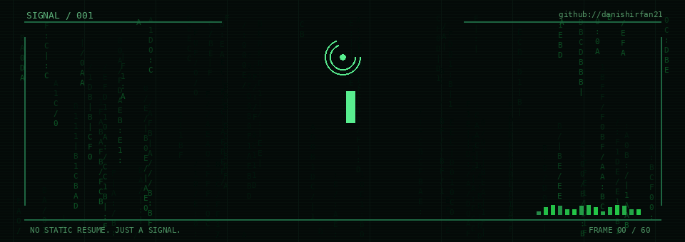
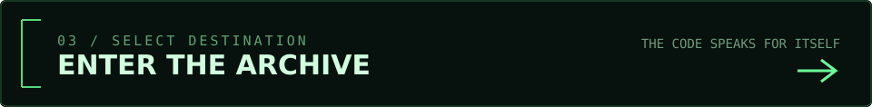
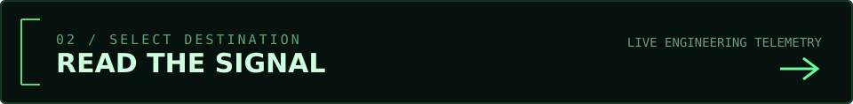
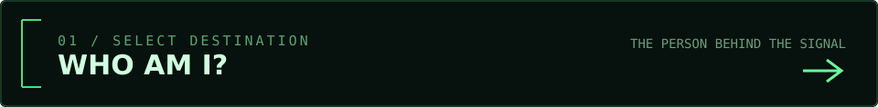
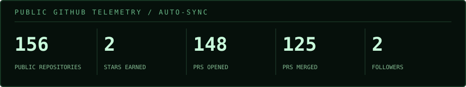

 

**Not another résumé. A signal from the machine.**

I'm Danish Irfan. I build software, investigate systems, and enjoy making technology feel alive.

  

 

<h2>Live telemetry</h2>

 

## About the signal

I’m a full-stack software engineer interested in the intersection of **products, intelligent workflows, and reliable systems**. Instead of keeping a manual catalogue of projects here, I let the repositories and activity speak for themselves.

FULL-STACK ENGINEERING • AI WORKFLOWS • AUTOMATION

Built to evolve. Updated by GitHub Actions. No runtime JavaScript.

